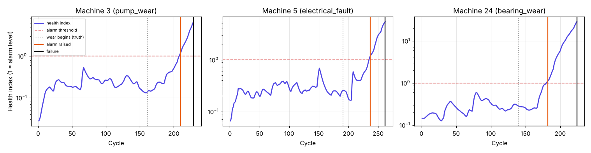
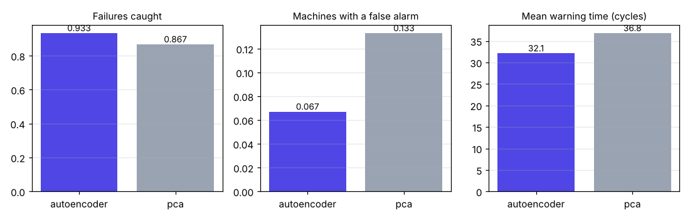

# 🛠️ Predictive Maintenance with an Autoencoder

A deep learning project that **warns you before a machine fails**. An autoencoder learns what a *healthy* machine looks like from its sensor data. When wear begins, the readings stop fitting what it learned, the reconstruction error climbs, and the system raises an alarm, tells you **which sensors look wrong**, and gives a rough estimate of the **remaining useful life**.

It includes the full pipeline (simulated data, training, evaluation, command-line tools) and a **web dashboard** where you can replay any machine cycle by cycle.



*Health index of three machines the model never saw during training. It stays low while the machine is healthy, then rises steeply once wear begins. The orange line is when the alarm was raised, and the black line is the failure.*

## Features
- **Anomaly detection with a PyTorch autoencoder**, trained on healthy data only (no failure examples needed)
- **Health index** and **alarm logic**: smoothed error, glitch filter, an alarm that needs several bad cycles in a row, and four status levels: normal, watch, warning, critical
- **Root cause hints**: shows which sensors deviate most (for example, vibration and bearing temperature for a bearing fault)
- **Rough remaining useful life (RUL) estimate** after an alarm
- **Honest evaluation** on machines never used for training, against a **PCA baseline**
- **Web dashboard**: live replay, charts, sensor clues, model results, and upload your own CSV
- Command-line tools to train, evaluate and score data, and a **simulator** that creates run-to-failure data
- Works with your own data (any CSV with machine id, time and sensor columns)
- 25 tests, including one that checks that the root-cause sensors for each fault type show up

## How it works

```
sensor readings ─► standardise ─► autoencoder ─► reconstruction error ─► health index ─► alarm / status / RUL
 (last 3 cycles)   (healthy stats)  (27→32→16→3→16→32→27)   per sensor, vs normal        smoothed over time
```

1. **Train on healthy data.** The first 40% of each training machine's life is assumed healthy. The autoencoder squeezes the readings (the last 3 cycles of 9 signals) through a 3-number bottleneck and tries to rebuild them. It learns the normal relationships, for example how temperature, pressure and vibration move with the load.
2. **Score new data.** The rebuild error of each sensor is divided by what is normal for that sensor, and averaged. A value of about 1 means typical healthy behaviour.
3. **Make the error trustworthy.**
   - *Warm-up correction*: every machine is a little different, so its first 20 cycles are used as its own zero point.
   - *Rolling median*: ignores isolated sensor glitches.
   - *Smoothing (EWMA)*: removes noise but follows real trends.
4. **Alarm.** The threshold is set from healthy validation machines (99.5th percentile). The alarm needs the health index above the threshold for 3 cycles in a row and then stays on. Status is *watch* when close to the threshold, *warning* after the alarm, and *critical* at 3 times the threshold.
5. **Remaining life.** After the alarm, the recent trend of the health index is extended until it reaches the level seen at failure in the training machines.

## Results

Evaluated on **15 simulated machines never used for training** (`python train.py`), compared with a linear PCA model using the same pipeline:

| | Autoencoder | PCA baseline |
|---|---|---|
| Failures caught before they happen | **14 of 15 (93%)** | 13 of 15 (87%) |
| Machines with a false alarm | **1 of 15 (7%)** | 2 of 15 (13%) |
| Mean warning time before failure | 32 cycles | 37 cycles |
| Shortest warning time | 18 cycles | 24 cycles |
| AUROC, healthy vs last 50 cycles | 0.944 | 0.956 |
| RUL error after alarm (mean absolute) | 47 cycles | 85 cycles |
| RUL error in the last 50 cycles | 29 cycles | 33 cycles |

Typical machine life is about 230 cycles, so a 32 cycle warning is roughly 14% of the life. Your numbers may differ slightly from these (different PyTorch versions or hardware give slightly different training results).



**Please read this honestly:**
- The data is **simulated**. Real machines are messier, and real results will differ.
- With only 15 test machines, one machine changes a percentage by 7 points. As a sturdier check, across **3 other simulated fleets (45 test machines)** the same settings caught 98% of failures with 2% false alarms (AUROC 0.986). Those fleets were also used to choose the settings, so treat that figure as slightly optimistic.
- The autoencoder and PCA are **close**. The simulated sensors depend only mildly non-linearly on the load, so a linear model works well. The autoencoder's advantage here is mainly **fewer false alarms and better RUL estimates**. On real machines with strongly non-linear behaviour, the gap can be bigger.
- The one false alarm (machine 28) was a brief excursion of 1.2 times the threshold for 3 cycles when the load switched from high to low. A longer patience or a higher threshold margin trades a later warning for fewer false alarms.
- The RUL estimate is **rough** (typically off by 30 to 50 cycles). Use it as a guide for planning, not as a promise.

## Quick start

Requires Python 3.9 or newer.

```bash
# 1. (optional) create a virtual environment
py -m venv .venv
.venv\Scripts\activate           # Windows
# source .venv/bin/activate        # macOS / Linux

# 2. install dependencies (includes PyTorch, a large download)
pip install -r requirements.txt

# 3. start the dashboard (a trained model and sample data are included)
python app.py
```
Open **http://127.0.0.1:5000**. On Windows, use `py` instead of `python` if `python` doesn't work.

### Using the dashboard
1. Pick a machine. Machines marked *unseen test machine* were not used for training.
2. Press **Play** to replay its life. Watch the health index rise, the status change and the sensor clues appear. Drag the slider or click a chart to jump to any cycle.
3. Look at **Most abnormal sensors** to see where the problem is. The sample data has three fault types: bearing wear, pump wear and electrical fault.
4. At the bottom, **upload a CSV** to score your own data and download the results.

### Command line
```bash
python train.py                         # train, evaluate against PCA, save model and figures (about 15 seconds)
python evaluate.py                      # show results per machine for the saved model
python predict.py data/sensor_data.csv --out predictions.csv    # score a file
python generate_data.py --units 100 --seed 3                    # create a new simulated dataset
python -m unittest discover -s tests -v                          # run the tests
```

## Use your own data

Your CSV needs **one row per machine and time step**, a machine id column, a time or cycle column, and numeric sensor columns. Machines should be run-to-failure (each series ends when the machine failed or was replaced).

```bash
python train.py --data my_machines.csv --unit-col machine_id --cycle-col hour --features temp vibration current pressure
```
- `--healthy-fraction 0.4` is the share of each machine's life assumed healthy. Choose a period you trust.
- `--window`, `--latent` and `--epochs` change the model. `--truth file.csv` (columns `unit`, `degrade_start`) lets you evaluate against known wear start times. Without it, the evaluation assumes wear starts after the healthy period.
- If you have only healthy data (no failures), the alarm still works, but there is no RUL estimate.
- Then run `python app.py --data my_machines.csv`.

## Web API

| Endpoint | Description |
|---|---|
| `GET /api/model` | Settings, threshold and evaluation metrics |
| `GET /api/units` | All machines with their alarm cycle and final status |
| `GET /api/unit/<id>` | Health index, status, sensors, sensor clues and RUL for one machine |
| `POST /api/score` | Upload a CSV (form field `file`). Returns a summary per machine and the full results as CSV text |

## Project structure
```
predictive-maintenance-autoencoder/
├── app.py                # web dashboard (Flask)
├── train.py              # train + evaluate + save
├── evaluate.py           # evaluate the saved model
├── predict.py            # score a CSV file
├── generate_data.py      # create simulated data
├── pdm/
│   ├── simulate.py       # run-to-failure simulator (3 fault types)
│   ├── data.py           # scaling, windows, splits, CSV loading
│   ├── model.py          # PyTorch autoencoder + training loop
│   ├── detect.py         # health index, alarm, status, sensor clues, RUL
│   ├── pipeline.py       # training pipeline, calibration, save / load
│   ├── evaluate.py       # metrics
│   └── plots.py          # figures
├── data/                 # sensor_data.csv, ground_truth.csv (simulated)
├── models/               # autoencoder.pt, config.json
├── assets/               # figures
├── templates/ static/    # dashboard
└── tests/
```

## Limitations and ideas
- Simulated data only. Try the NASA C-MAPSS turbofan dataset or your own machine logs.
- The model assumes the first part of life is healthy and that load or operating conditions are among the inputs.
- Ideas: LSTM or convolutional autoencoders, variational autoencoders, per-sensor thresholds, a proper RUL regression model, drift detection, and streaming input from a live data source.

## License
MIT. See [LICENSE](LICENSE).
"# Predictive-maintenance-autoencoder" 
